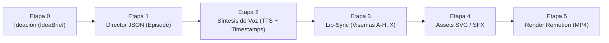

# Arquitectura del Sistema — Orquestador de Videos Animados 2D (Remotion)

> **Entorno Objetivo:** Apple Silicon MacBook Air M5 (`darwin-arm64`) · 16 GB Unified Memory  
> **Stack Principal:** TypeScript · Remotion 4 · TailwindCSS · Zod · Lucide React

---

## 1. Visión General de la Arquitectura

El sistema está diseñado como un **pipeline determinista y declarativo de 6 etapas** orientado a producir episodios animados 2D de alta retención (1920x1080 @ 30fps) con mínima huella de memoria RAM. Cada etapa se comunica exclusivamente mediante **contratos de datos inmutables validados con Zod**, permitiendo:

- **Ejecución modular e idempotente:** Cualquier etapa puede re-ejecutarse o simularse con mocks sin acoplamiento con proveedores externos.
- **Control estricto de memoria (presupuesto < 12 GB pico en 16 GB RAM):** Procesamiento secuencial por escena durante TTS/Lip-Sync y concurrencia controlada en el renderizado de Remotion.
- **Separación de responsabilidades:** La lógica creativa y de sincronización vive en el pipeline (`src/pipeline/`), mientras que `src/remotion/` opera como un motor de renderizado puro (stateless frame-by-frame).



---

## 2. Flujo de 6 Etapas del Pipeline

### Etapa 0: Ideación (`IdeaBriefSchema`)
- **Entrada:** Tema semilla, tendencias o prompt editorial.
- **Proceso:** Análisis de potencial viral, extracción de datos duros comparativos (`hardStats`) y ángulos de comedia/sátira (`humorAngles`).
- **Salida:** Objeto validado por `IdeaBriefSchema` (`src/schema/idea.schema.ts`) con estado `pending` | `approved` | `produced`, `viralScore` (1–100) y `hook` inicial.

### Etapa 1: Director JSON (`EpisodeSchema` inicial)
- **Entrada:** `IdeaBrief` aprobado (`status: "approved"`).
- **Proceso:** Transformación del brief en un guion técnico estructurado por escenas (`scenes`). Para cada escena, el "Director" asigna:
  - Diálogo (`dialogue`) y locutor (`narrator` | `character_b`).
  - Pose emocional del personaje (`neutral`, `explaining`, `shocked`, `sarcastic`, `angry`, `dizzy`).
  - Acción de cámara 2D (`static`, `zoom_in_slow`, `zoom_in_fast`, `shake`, `pan_left`).
  - Efecto de sonido puntual (`whoosh`, `pop`, `ding`, `record_scratch`, `none`).
  - Plantilla visual discriminada (`visualTemplate`):
    - `character_focus`: Personaje protagonista + subtítulos dinámicos / callout.
    - `infographic_split`: Comparativa lado a lado (ej. Expectativa vs. Realidad, Antes vs. Después).
    - `infographic_counter`: Contador numérico animado de alto impacto con contexto comparativo.
    - `infographic_list`: Lista progresiva de puntos clave con iconografía vectorial.
- **Salida:** Borrador de `Episode` validado por `EpisodeSchema` (`src/schema/episode.schema.ts`).

### Etapa 2: Síntesis de Voz y Timestamps (TTS)
- **Entrada:** Escenas del `Episode` con sus textos de `dialogue`.
- **Proceso:** Generación de pistas de audio `.wav`/`.mp3` por escena y extracción de marcas de tiempo por palabra (`wordTimestamps: [{ word, start, end }]`).
- **Ajuste de Duración:** Se recalcula `durationInFrames = Math.ceil((audioDurationSec + paddingSec) * fps)` para garantizar sincronía exacta al frame.
- **Salida:** Archivos de audio en `public/assets/audio/` y actualización de `wordTimestamps` y `durationInFrames` en el JSON del episodio.

### Etapa 3: Lip-Sync Automatizado (Rhubarb / Fonemas a Visemas)
- **Entrada:** Archivos de audio por escena generados en la Etapa 2.
- **Proceso:** Análisis acústico/fonético (ej. Rhubarb Lip Sync sobre binario nativo `darwin-arm64`) que mapea el audio a las 9 formas de boca estándar de Preston Blair / Rhubarb:
  - `A`: Boca cerrada (sonidos *P, B, M*)
  - `B`: Dientes ligeramente juntos / consonantes (*K, S, T, D, N, Z*)
  - `C`: Vocal abierta media (*EH, AE*)
  - `D`: Vocal muy abierta (*AA, AH*)
  - `E`: Vocal redondeada media (*AO, ER*)
  - `F`: Labios fruncidos (*UW, OW, W*)
  - `G`: Dientes superiores sobre labio inferior (*F, V*)
  - `H`: Lengua visible detrás de dientes (*L, R*)
  - `X`: Silencio / reposo relajado
- **Salida:** Array `mouthCues: [{ start, end, value }]` inyectado en cada escena del `EpisodeSchema`.

### Etapa 4: Resolución y Validación de Assets SVG / SFX
- **Entrada:** `Episode` enriquecido con tiempos y visemas.
- **Proceso:**
  - Verificación de integridad de todos los assets vectoriales de poses (`public/assets/characters/<speaker>/<pose>.svg`) y bocas (`public/assets/characters/<speaker>/mouths/<viseme>.svg`).
  - Resolución de iconos vectoriales (`lucide-react`) y efectos de sonido (`public/assets/sfx/`).
- **Salida:** Manifiesto de episodio 100% validado y listo para renderizado determinista.

### Etapa 5: Renderizado en Remotion (`EpisodeComposition`)
- **Entrada:** JSON final validado por `EpisodeSchema` (`src/mocks/sample_episode.json` en Fase 1).
- **Proceso:**
  - `<Series>` secuencia las escenas según `durationInFrames`.
  - `<Camera2D>` aplica transformaciones físicas (`spring()` e `interpolate()`) sobre el lienzo 1920x1080.
  - `<CharacterRig>` calcula el segundo exacto (`useCurrentFrame() / fps`), busca en `O(1)`/`O(log n)` el `mouthCue` activo y superpone el SVG de la boca sobre el SVG de la pose base.
  - Las plantillas visuales (`CharacterFocus`, `InfographicSplit`, `InfographicCounter`, `InfographicList`) animan los datos y resaltan la palabra activa según `wordTimestamps`.
- **Optimización para MacBook Air M5 (16 GB RAM):**
  - Renderizado basado en SVG puros y CSS transforms acelerados por GPU.
  - Concurrencia ajustada a los núcleos de eficiencia/rendimiento del M5 sin desbordar el heap de Chromium headless.

---

## 3. Estructura de Directorios

```text
/
├── ARCHITECTURE.md
├── package.json
├── tsconfig.json
├── remotion.config.ts
├── tailwind.config.js
├── postcss.config.js
├── scripts/
│   └── generate-placeholders.ts        # Generador determinista de poses y bocas SVG
├── public/
│   └── assets/
│       └── characters/
│           └── narrator/
│               ├── neutral.svg
│               ├── explaining.svg
│               ├── shocked.svg
│               ├── sarcastic.svg
│               ├── angry.svg
│               ├── dizzy.svg
│               └── mouths/
│                   ├── A.svg ... H.svg
│                   └── X.svg
└── src/
    ├── index.ts                        # Punto de entrada de Remotion (registerRoot)
    ├── style.css                       # Directivas de TailwindCSS y utilidades globales
    ├── schema/
    │   ├── idea.schema.ts              # Contrato Etapa 0 (IdeaBriefSchema)
    │   └── episode.schema.ts           # Contrato Etapas 1-5 (EpisodeSchema + VisualTemplates)
    ├── remotion/
    │   ├── Root.tsx                    # Registro de <Composition id="Episode" />
    │   ├── EpisodeComposition.tsx      # Orquestador <Series> de escenas
    │   ├── components/
    │   │   ├── Camera2D.tsx            # Motor de cámara 2D con spring() e interpolate()
    │   │   └── CharacterRig.tsx        # Rig 2D de poses + lip-sync por visemas
    │   └── templates/
    │       ├── CharacterFocus.tsx      # Plantilla: Foco en personaje + subtítulos dinámicos
    │       ├── InfographicSplit.tsx    # Plantilla: Comparativa dividida (Split Screen)
    │       ├── InfographicCounter.tsx  # Plantilla: Contador estadístico animado
    │       └── InfographicList.tsx     # Plantilla: Lista animada de puntos clave
    ├── pipeline/                       # (Fase 2+) Módulos de ejecución Etapas 0-4
    ├── cli/                            # (Fase 2+) CLI de orquestación local
    └── mocks/
        └── sample_episode.json         # Episodio mock de 4 escenas validado con Zod
```
