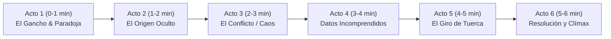

# Guía Técnica del Sistema y Roadmap para Videos de 6 Minutos

> **Documento:** Guía de Funcionamiento, Stack Tecnológico y Estrategia de Expansión para Producción de Videos de Media Duración (~6 min)  
> **Plataforma Objetivo:** Apple Silicon M5 (`darwin-arm64`) · 16 GB Unified Memory  
> **Tecnologías Centrales:** Remotion 4, TypeScript, Zod, TailwindCSS, Antigravity CLI (`agy`), Rhubarb Lip-Sync, EdgeTTS

---

## 1. ¿Qué hace este proyecto a nivel de funcionamiento?

Este proyecto es una **fábrica automatizada de videos animados 2D en código** (*Programmatic Video Generation*). En lugar de abrir Premiere, After Effects o Blender para diseñar y animar a mano cada escena, el sistema utiliza un **pipeline determinista de 6 etapas** que transforma una simple temática o nicho en un archivo de video final en formato `.mp4` (1080p a 30 FPS) con voz sincronizada, movimiento de cámara, expresiones de personajes, infografías animadas y efectos de sonido.

### El Flujo de las 6 Etapas

```mermaid
flowchart TD
    A["Etapa 0: Ideador Viral\n(CLI Antigravity 'agy')"] -->|"IdeaBriefSchema\n(Hook, Hard Stats, Humor)"| B["Etapa 1: Director IA\n(Showrunner Scriptwriter)"]
    B -->|"EpisodeSchema\n(Escenas de 6-8s con plantillas)"| C["Etapa 2: Síntesis de Voz TTS\n(EdgeTTS / Kokoro local)"]
    C -->|"Archivos WAV + Timestamps por palabra"| D["Etapa 3: Lip-Sync Fonético\n(Rhubarb / Visemas A-H, X)"|
    D -->|"mouthCues sincronizados a 30fps"| E["Etapa 4: Consolidación de Assets\n(SVGs 500x600, SFX sintetizados)"|
    E -->|"current_episode.json validado"| F["Etapa 5: Render Remotion\n(Chromium Headless + GPU M5)"]
    F --> G["Video Final: out/episode.mp4\n(1920x1080 @ 30 FPS)"]
```

1. **Etapa 0 (Ideación Viral):** Un generador consulta al modelo de lenguaje (mediante el CLI nativo de Antigravity `agy`) bajo un prompt de productor de YouTube (estilo Kurzgesagt / Fireship). Genera ideas que compiten con un `viralScore` (1-100), ganchos extremos para los primeros 5 segundos, estadísticas duras y ángulos de humor ácido. Las guarda en `src/generated/ideas_backlog.json`.
2. **Etapa 1 (Director IA):** Toma la idea pendiente con mayor puntaje y la traduce en un guion técnico cinematográfico (`EpisodeSchema`). Define para cada escena: locutor, diálogo corto (15-20 palabras), pose emocional del personaje, movimiento de cámara 2D, efecto de sonido y una de las 4 plantillas visuales.
3. **Etapa 2 (Síntesis de Voz y Timestamps TTS):** Genera la locución en español neutro (`es-MX-JorgeNeural`). Extrae marcas de tiempo por palabra (`wordTimestamps`) y recalcula la duración exacta de cada escena en cuadros (`durationInFrames = Math.ceil(duracionSegundos * 30)`).
4. **Etapa 3 (Lip-Sync Fonético):** Pasa cada archivo `.wav` por **Rhubarb Lip-Sync** para calcular los visemas exactos (bocas A, B, C, D, E, F, G, H y reposo X). Si Rhubarb no estuviese disponible, entra un algoritmo de análisis silábico de respaldo.
5. **Etapa 4 (Consolidación de Assets):** Verifica que los SVGs cel-shaded (poses y bocas en proporción fija 500x600) y los efectos de sonido `.wav` existan, enlazando las rutas de audio a cada escena.
6. **Etapa 5 (Render Remotion):** Remotion levanta Chromium headless y renderiza cuadro a cuadro a 1920x1080 utilizando aceleración gráfica por hardware. La concurrencia está calibrada en `3` hilos para mantener el uso de RAM por debajo de 8 GB en el MacBook Air M5.

---

## 2. Herramientas utilizadas y cómo operan

| Herramienta / Librería | Rol en el Sistema | Cómo lo hace técnicamente |
| :--- | :--- | :--- |
| **Remotion 4** | Motor de Renderizado de Video en React | Permite programar animaciones como componentes funcionales de React. Utiliza hooks como `useCurrentFrame()` y utilidades como `spring()` e `interpolate()` para calcular transformaciones matemáticas en lugar de depender de keyframes fijos. |
| **Zod** | Contratos de Datos e Inmutabilidad | Valida estrictamente cada estructura de datos (`IdeaBriefSchema`, `EpisodeSchema`, `VisualTemplateSchema`). Si la IA omite un campo o genera un tipo inválido, el sistema detecta el error antes de renderizar un solo cuadro. |
| **Antigravity CLI (`agy`)** | Conector LLM Headless | Ejecuta consultas al modelo de lenguaje mediante procesos hijos (`child_process.spawn`) usando el comando nativo `agy -p "<prompt>" --output-format text`. Evita bloqueos por cuotas de APIs públicas y no requiere API keys en el código. |
| **TailwindCSS 3** | Motor de Estilos Visuales | Diseña las plantillas visuales con paletas oscuras de alto contraste (estilo *Sci-Fi / Modern Dark UI*), garantizando cumplimiento con el *Broadcast Safe Area* (márgenes seguros de 68px arriba/abajo y 96px a los lados). |
| **Lucide React** | Iconografía Vectorial Limpia | Brinda iconos SVG geométricos y minimalistas para ilustrar métricas, llamadas de atención y comparativas sin ralentizar el renderizado. |
| **EdgeTTS (`node-edge-tts`) + `afconvert`** | Síntesis de Voz Neural | Descarga el stream de voz natural en español y utiliza la herramienta nativa de macOS `/usr/bin/afconvert` para convertir el audio a un formato sin compresión WAV PCM 16-bit a 24 kHz compatible con herramientas de análisis fonético. |
| **Rhubarb Lip-Sync** | Análisis Acústico y Mapeo de Visemas | Analiza la pista de audio y genera los rangos de tiempo de apertura bucal basados en el estándar de animación de Preston Blair. |
| **WaveFile (`wavefile`)** | Síntesis Procedimental de Audio (SFX) | Genera matemáticamente mediante osciladores y filtros en buffers crudos los efectos sonoros (`whoosh.wav`, `pop.wav`, `ding.wav`, `record_scratch.wav` y la cama de fondo `bg_loop.wav`). |
| **Commander & TSX** | CLI y Ejecución sin Compilación Previa | Permite ejecutar comandos directamente (`npm run ideate`, `npm run produce`, `npm run render`) interpretando TypeScript en tiempo de ejecución. |

---

## 3. El Rig de Animación 2D Cel-Shaded

Para que el personaje se vea como en una producción de televisión (estilo *Kurzgesagt* o *Gravity Falls*), el sistema utiliza una regla geométrica estricta:

1. **Lienzo Compartido:** Tanto las 6 poses base (`neutral`, `explaining`, `shocked`, `sarcastic`, `angry`, `dizzy`) como las 9 bocas de visemas comparten el mismo `viewBox="0 0 500 600"`.
2. **Punto de Anclaje Matemático `(cx: 250, cy: 245)`:** La boca está dibujada en esa coordenada exacta dentro de su propio lienzo transparente. Las poses dejan esa zona completamente limpia. De este modo, Remotion solo necesita superponer ambas imágenes con `position: absolute; inset: 0`, garantizando que la boca nunca se desplace al hablar o cambiar de pose.
3. **Movimiento Secundario Procedimental (`Secondary Motion`):**
   - **Parpadeo Orgánico:** Cada 90 cuadros (aprox. 3 segundos a 30 FPS), durante 4 cuadros (`frame % 90 < 4`), se superponen dos líneas horizontales sobre los ojos para simular un parpadeo natural sin necesidad de añadir fotogramas clave a mano.
   - **Head Bobbing:** Cuando el personaje está hablando (`activeViseme !== 'X'`), se aplica un ligero vaivén armónico vertical `Math.sin(frame / 10) * 4.5px` para que no luzca rígido como una imagen estática.

---

## 4. Estrategia y Mejoras para Videos de 6 Minutos (YouTube Mid-Form)

Un video de 30 a 45 segundos funciona bien con 4 escenas simples. Sin embargo, un video de **6 minutos (360 segundos / 10,800 frames a 30 FPS)** con unas **35 a 50 escenas** requiere resolver dos grandes desafíos:
1. **El Desafío Cognitivo (Retención del Espectador):** Evitar que el video se sienta monótono, repetitivo o que parezca una diapositiva leída por una máquina.
2. **El Desafío Técnico (Rendimiento en 16 GB de RAM):** Evitar saturar la memoria unificada del MacBook Air M5 al renderizar 10,800 cuadros con audio y gráficos pesados.

A continuación se detallan las **5 mejoras óptimas** necesarias para escalar la arquitectura:

---

### Mejora 1: Arquitectura Narrativa en 6 Micro-Capítulos con "Pattern Interrupts"

En videos de media duración, la retención cae drásticamente si no hay cambios de ritmo cada 15-20 segundos. Se debe estructurar el guion en **6 actos de 60 segundos**:



- **Estructura de Micro-Bucle (cada 45-60 s):** Cada acto debe tener su propio mini-gancho, desarrollo con tensión creciente, revelación de dato y remate irónico.
- **Interrupciones de Patrón (*Pattern Interrupts*):**
  - Cada 3 escenas: Cambio abrupto de encuadre (primer plano dramático o alejamiento total).
  - Cada 45 segundos: Pausa de silencio dramático (0.5 s sin música ni voz antes de un golpe sonoro).
  - Efectos visuales de impacto: pantalla en blanco (*flash frame* de 2 cuadros) o cambio de color de fondo del tema oscuro a un contraste de advertencia.

---

### Mejora 2: Sistema Dialéctico de 2 Personajes (Co-Host / Antagonista)

El monólogo extendido cansa. La solución de los canales más exitosos es el **diálogo dialéctico** entre dos perspectivas:

- **Personaje A (`narrator`):** El presentador con hoodie naranja; analítico, rápido, sarcástico y basado en datos.
- **Personaje B (`character_b`):** Un co-presentador o antagonista con diseño visual opuesto (por ejemplo, hoodie azul o verde, expresión incrédula o corporativa).
- **Dinámica en pantalla:**
  - Alternancia ágil de turnos (réplicas de 5 a 8 segundos).
  - Reacciones silentes del que escucha: mientras A explica, B muestra la pose `shocked` o `dizzy` con parpadeo activo en el fondo.

---

### Mejora 3: Expansión del Catálogo a 10+ Plantillas Visuales

Actualmente existen 4 plantillas (`CharacterFocus`, `InfographicSplit`, `InfographicCounter`, `InfographicList`). Para 6 minutos se requiere un repertorio más amplio para que ninguna plantilla se repita de forma consecutiva:

```text
/src/remotion/templates/
├── CharacterFocus.tsx         # [Existente] Monólogo principal + titular
├── InfographicSplit.tsx       # [Existente] Comparativa A vs B
├── InfographicCounter.tsx     # [Existente] Contador numérico gigante
├── InfographicList.tsx        # [Existente] Lista escalonada de 3 puntos
│
│   === NUEVAS PLANTILLAS PROPUESTAS PARA 6 MINUTOS ===
├── DialogueDual.tsx           # Dos personajes interactuando frente a frente en pantalla dividida
├── TimelineJourney.tsx        # Línea de tiempo horizontal con años/etapas que avanzan dinámicamente
├── TerminalCode.tsx           # Ventana de consola de comandos con texto tipográfico estilo hacker/IDE
├── BentoGrid.tsx              # Cuadrícula modular moderna de 4 tarjetas con métricas e iconos
├── KineticQuote.tsx           # Cita o frase monumental a pantalla completa con tipografía cinética
└── FlowchartDiagram.tsx       # Diagrama de flujo de decisiones con flechas animadas y nodos
```

---

### Mejora 4: Banda Sonora Adaptativa con *Audio Ducking* Automático

En un video de 6 minutos, un solo loop de fondo aburre. Se debe implementar un sistema de sonido dinámico:

1. **Multi-Track por Acto:** 3 pistas musicales distintas para reflejar el estado de ánimo (Curiosidad/Misterio -> Tensión/Ritmo rápido -> Conclusión épica).
2. **Audio Ducking Inteligente:** Bajar automáticamente el volumen de la música de fondo a un 15% (`-16 dB`) durante las frases de voz, y elevarlo al 60% (`-4 dB`) en pausas dramáticas o remates cómicos.
3. **Puntuación Sonora Contextual:** Efectos SFX precisos en cada transición de escena (quitar el sonido plano y sincronizar swooshes, clicks mecánicos y glitches).

---

### Mejora 5: Renderizado por Bloques (*Chunked Rendering*) y Guion en Multi-Paso

Para evitar saturar la memoria RAM y permitir iteraciones rápidas en un video largo:

#### A. Generación de Guion en 3 Fases (Evita que el LLM comprima el contenido)
Un modelo de lenguaje no suele escribir un guion de 6 minutos de alta calidad en un solo intento. El pipeline del Director debe dividirse en 3 pasos:
- **Paso 1: Escaleta de Actos:** Define los 6 micro-capítulos y sus giros temáticos.
- **Paso 2: Guion Literario:** Redacta los diálogos completos de cada acto (aprox. 120-150 palabras por minuto, ~800 palabras en total).
- **Paso 3: Compilador a JSON (`EpisodeSchema`):** Traduce cada bloque en escenas de 6 a 8 segundos con sus parámetros visuales y de cámara.

#### B. Renderizado por Chunks con Concatenación FFmpeg
En lugar de renderizar 10,800 cuadros en un solo proceso de Chromium:
1. Renderizar cada acto de 1 minuto como un archivo independiente (`act_01.mp4`, `act_02.mp4`, ...).
2. Concatenar los 6 archivos finales de manera instantánea y sin pérdida de calidad usando el demuxer nativo de FFmpeg:
   ```bash
   ffmpeg -f concat -safe 0 -i chunks_list.txt -c copy out/episode_6min_final.mp4
   ```
   *Ventaja:* Si se desea cambiar únicamente la escena 24 del minuto 4, solo se re-renderiza el bloque de ese minuto, ahorrando un 85% de tiempo de computación.

---

## 5. Resumen de Próximos Pasos Recomendados

| Prioridad | Tarea / Módulo | Beneficio directo |
| :---: | :--- | :--- |
| **Alta** | Implementar `DialogueDual.tsx` y `TimelineJourney.tsx` | Rompe la monotonía visual y permite debatir ideas complejas. |
| **Alta** | Incorporar *Audio Ducking* en `EpisodeComposition.tsx` | La voz resalta con claridad profesional sobre la música. |
| **Media** | Crear el comando `ideate-long` con generador en 3 pasos | Guiones extensos de 800 palabras sin pérdida de profundidad. |
| **Media** | Modularizar el render por actos con concatenación FFmpeg | Renderizado seguro, modular y tolerante a fallos en 16 GB RAM. |
